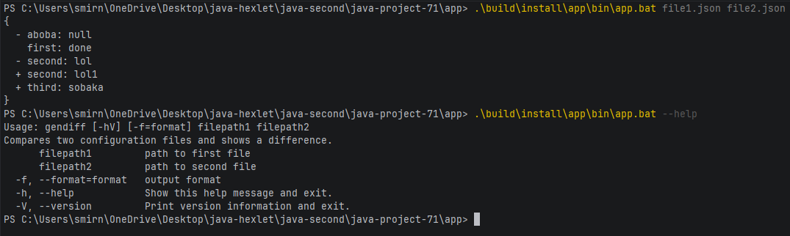
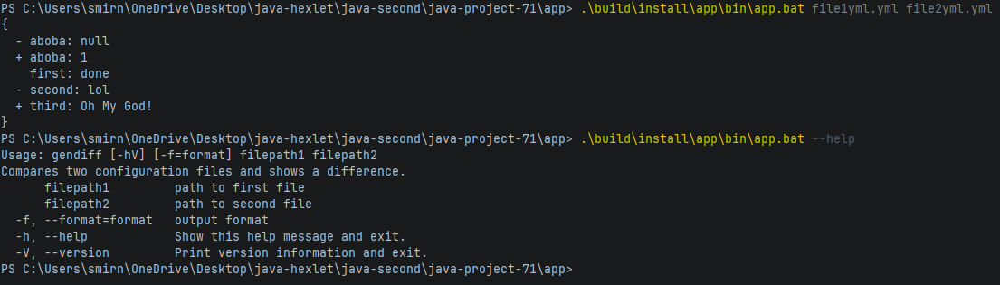
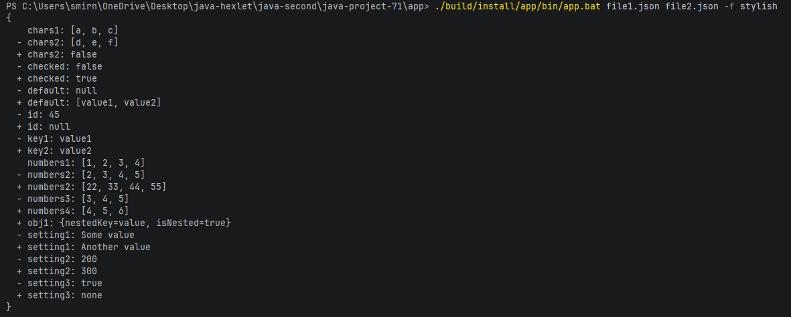
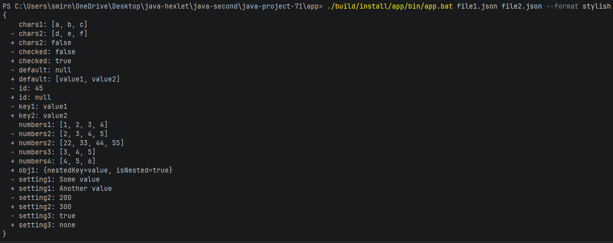
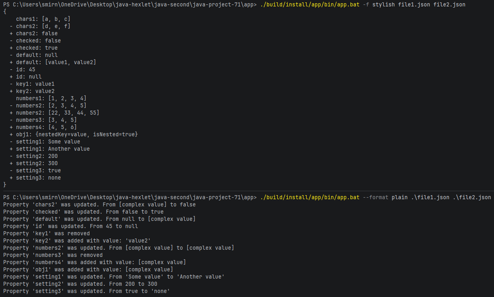
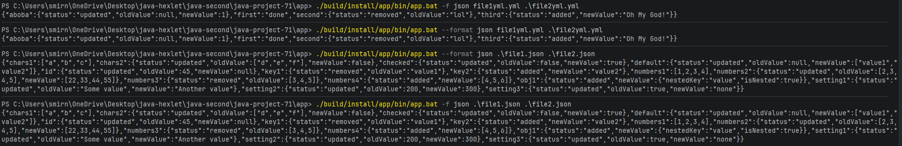

# Вычислитель отличий (Java)

[](https://github.com/h8masha/java-project-71/actions)
[](https://github.com/h8masha/java-project-71/actions/workflows/build-workflow.yml)

Консольная утилита, которая сравнивает два файла JSON или YAML по ключам первого уровня и выводит разницу в трёх форматах. Вы разбираете аргументы командной строки через picocli, читаете оба формата через Jackson и выносите каждый формат вывода в свой класс. Тесты на JUnit вы пишете сами, а сборка в GitHub Actions проверяет стиль и порог покрытия.

Учебный проект Хекслета: https://ru.hexlet.io/programs/java
Как это должно работать: https://asciinema.org/a/NFIQgLVMu1ymFsqg4ESeOQeXi

## Стек

- Java
- Picocli
- Jacoco
- JUnit
- Spotless
- jackson-databind

## Установка

<!-- Описание утановки: клонирование, зависимости, переменные окружения -->

```bash
git clone https://github.com/h8masha/java-project-71.git
cd java-project-71
```

## Использование


### Windows
```shell
cd app
.\gradlew.bat clean installDist build
.\build\install\app\bin\app.bat <path_to_file1> <path_to_file2>  
```

### Linux
```bash
cd app
./gradlew clean installDist build
./build/install/app/bin/app <path_to_file1> <path_to_file2>  
```

### Так же возможен запуск примера с файлами-примерами командой
```shell
make run-dist 
```
***Важно!*** При запуске этой команды вы должны убедиться в том, что на вашем компьютере установлена утилита make
```shell
make --version
```
## Пример использования c файлами .json


## Пример использования c файлами .yml

## Пример использования с возможностью выбора форматтера 
#### *по умолчанию* форматтер задан как **stylish**

#### Однако задать форматтер можно при помощи флага format: 
1. В краткой форме
> **-f "значение"**

2. В полной форме
> **--format "значение"**
> 

## Пример использования с вариативным выбором форматтера (plain)


## Примеры использования с вариативным выбором форматтера (json)


